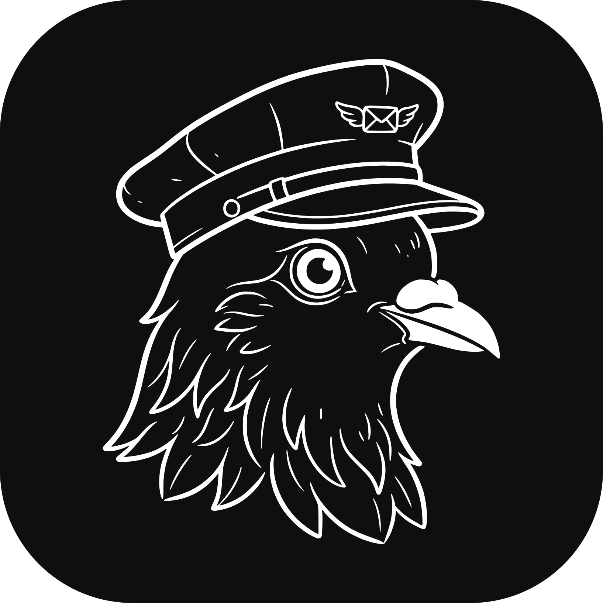

# Pigeonslip

**Website:** https://pigeonslip.ravenburst.com · **Download:** [latest release](https://github.com/matpitts13/pigeonslip/releases/latest)

A free Windows app that prints shipping labels at the standard USPS 4 × 6 in size, fitting as many as it can on each sheet.

Shipping label downloads from TikTok Shop, eBay, Etsy and others often put one label on a full letter page. Printed as-is, the label comes out too big to tape on a package. Pigeonslip trims each label to its printed area, sizes it to exactly 4 × 6 in, and puts two on each letter sheet with dashed cut lines.

## Use it

1. Drop label PDFs or pictures onto the window, or click **Browse files…** (pick one or several).
2. Check the preview. Each PDF page becomes one label. Blank pages are skipped.
3. Click **Print labels** (Ctrl+P) and choose your printer. Keep the scale at **100% / Actual size**.

Or click **Save PDF** (Ctrl+S) to keep a print-ready file.

| Paper | Labels per sheet |
| --- | --- |
| Letter (8.5 × 11 in) | 2 |
| A4 | 2 |
| 4 × 6 in label roll (thermal printers) | 1 |

**Settings**
- **Trim white margins**: crops each page to its printed area. Turn it off for labels that are already 4 × 6 in with a white border you want to keep.
- **Cut lines**: dashed lines just outside each label, to cut along.

The app remembers your settings.

**What it reads:** PDF, PNG, JPG, GIF and WebP. Saved PDFs keep PDF labels as vector art, so barcodes stay sharp. Printing uses a 300 dpi picture of each label.

**Limits:** the app trims to *everything* printed on a page. A layout with a label on one half and a receipt or instructions on the other (some carriers' "letter, 2-up" downloads) is kept whole. Choose the 4 × 6 in download format on those sites instead.

## Run from source

Needs Node.js 22 or newer.

```
npm install
npm start           # run the app
npm test            # unit tests
npm run smoke       # load the window, fail on any console error, save a screenshot
npm run smoke -- a.pdf b.png   # also load files, write .smoke/smoke.pdf and the print output
npm run dist        # build the Windows installer and portable .exe into dist/
```

## Privacy

Everything happens on your computer. The app has no network access, no accounts, no analytics. Files are read only when you drop or pick them, and only the PDFs you save are written.

## License

MIT. Not affiliated with the United States Postal Service or any marketplace.
